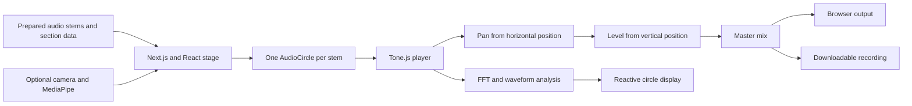

# Spatial Music Lab

An interactive spatial-audio study built for the NYU Shanghai Creative Innovation Lab. Learners move sound sources across a visual stage and hear how position changes a mix: left and right control stereo pan; up and down control level. Yiting Liu designed and developed the browser experience as an Adjunct Researcher in Music and AI.

**[Try the live demo](https://interactive-music-test-2.vercel.app/)** · [Watch the silent interaction clip](my-app/public/demo/spatial-music-lab-demo.mp4) · [Read the system architecture](docs/architecture.md)

The clip shows playback, dragging an instrument, and jumping between song sections. Open the live demo to hear the mix.

## What you can do

1. Press **Play** to hear the prepared stems together.
2. Drag a colored instrument circle horizontally to change its stereo position, or vertically to change its level. Circle size adapts to the stage so the sources remain visible at different window sizes.
3. Use the timeline or section buttons to move through the composition. Turn looping on when comparing a passage.
4. Use **Record mix** to capture and download the current browser mix as a WebM file.
5. Optionally enable **hand control**. The browser requests camera access, and MediaPipe hand landmarks support grab, move, and release gestures.

The home route loads Justin Scholar's Chinese instrumental example. The `/airtraffic` route demonstrates another prepared mix. Camera control is optional; mouse interaction works without it.

## How it works



See [the architecture notes](docs/architecture.md) for the component and interaction flow. The current public demo mixes prepared audio stems. Older microphone-loop components remain in the repository but are outside the current demo flow.

## Run locally

Requires Node.js 20 or newer and npm.

```bash
git clone https://github.com/YitingLiu97/interactive-music-test-2.git
cd interactive-music-test-2/my-app
npm ci
npm run dev
```

Open `http://localhost:3000`. Run `npm run build` to check the production build.

## Add a composition

Create `my-app/public/content/<slug>/` with an `info.json`, an `image/bg.jpg`, and audio files under `sounds/`. Use [`justintest/info.json`](my-app/public/content/justintest/info.json) or [`airtraffic/info.json`](my-app/public/content/airtraffic/info.json) as the schema reference. The metadata supplies audio paths, circle colors, track names, and section timings. The composition becomes available at `/<slug>`.

## Stack and credits

Next.js, React, TypeScript, Tailwind CSS, Tone.js, and MediaPipe Tasks Vision. The project was created for the NYU Shanghai Creative Innovation Lab led by Alex Ruthmann. Demo music: **Chinese Instruments Music** by Justin Scholar 玉刻 and **The Magician's Wife** by Clara Berry and Wooldog (Air Traffic example).

This is a research prototype. It demonstrates browser-based spatial mixing and optional gesture input; it does not include collaborative sessions, MIDI control, or machine-learning audio analysis.
