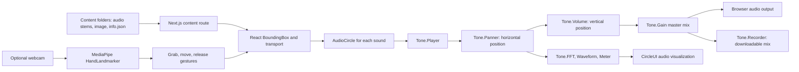

# Spatial Music Lab: implemented system

This document describes the current interactive-music-test-2 prototype. It separates implemented behavior from ideas listed as future enhancements in the README.

## Interaction flow

1. A content folder defines stems, metadata, section timing, source colors and positions, and a background image. The dynamic route loads it through `/api/content/[slug]`; the home route uses the bundled Justin Scholar example.
2. `BoundingBox` coordinates transport state, sound-source positions, timeline seeking, the optional hand-control mode, and the master mixer.
3. Each `AudioCircle` owns a `useAudioCircle` instance. A Tone.js player routes through a panner and volume node. Its position on the 2D canvas determines stereo pan and level. FFT, waveform, and meter nodes drive the circle visualization.
4. The master mixer routes the combined audio to the browser output and, when the user starts a mix capture, to a `Tone.Recorder` that provides a downloadable WebM file.
5. Optional camera control uses MediaPipe Tasks Vision to detect hand landmarks. Grab/move/release gestures update a sound source's canvas position. Camera permission is requested only after the user enables this mode.

## Scope of the current prototype

The implemented learning interaction is spatial mixing of prepared audio stems, with optional computer-vision gestures. The README lists machine-learning audio analysis, collaborative WebRTC sessions, and MIDI integration as future enhancements. Do not present those as shipped features. The older microphone-loop recorder components remain in the repository but are not part of the current public demo flow.
